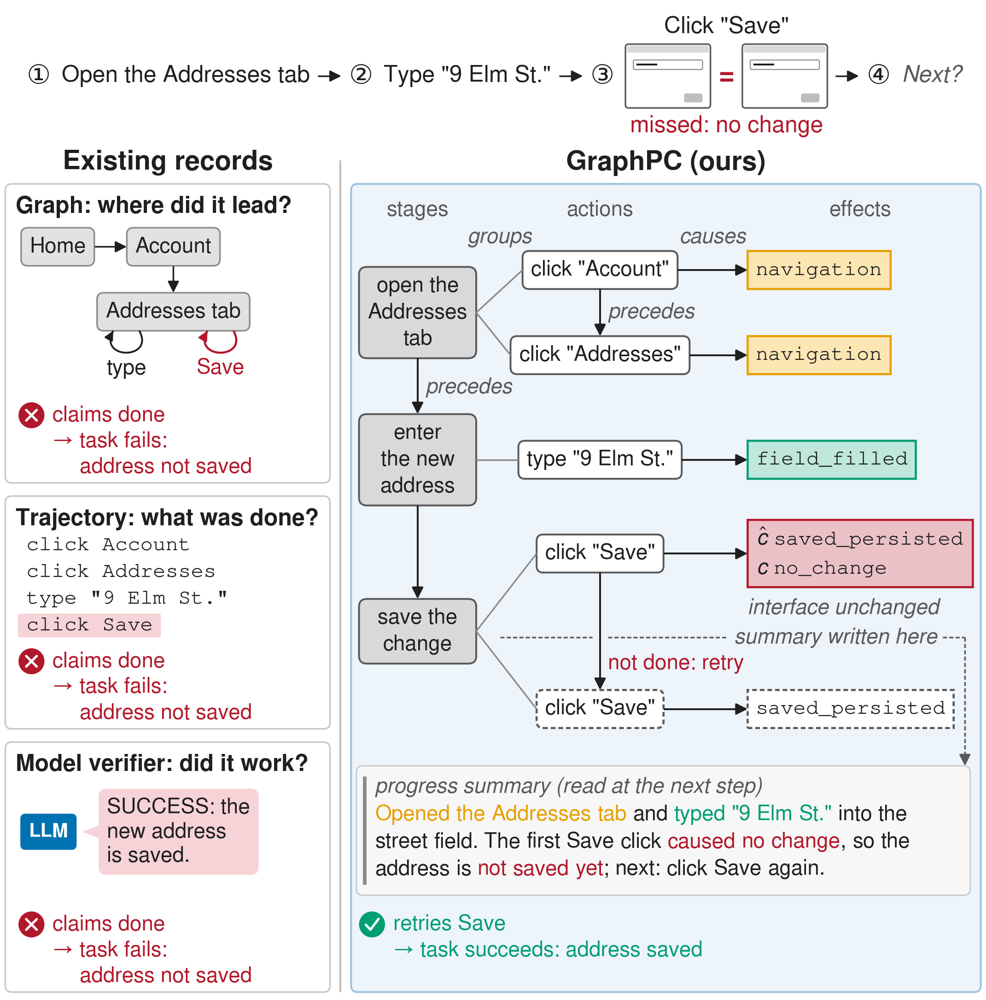

# GraphPC — From Actions to Effects: Procedure-Causal Graphs for Tracking Progress in Computer-Use Agents


GraphPC is a training-free harness that wraps an unmodified foundation model to carry out multi-step computer-use
tasks — on WebArena from the accessibility tree, on OSWorld 2.0 from screenshots. Its core is the procedure-causal
graph, a record of progress as the effects of actions: the model predicts each action's effect from a closed
vocabulary before acting and labels it afterwards, and a model-free test of whether the interface changed overrides a
progress label on an unchanged step. The same record manages context (a compressed summary the model rewrites every
step), verifies progress (a completion gate admitting a completion claim only on recorded evidence) and carries reusable
experience (successful episodes retrieved as effect-labelled procedures). Each step makes two model calls — a deciding
call that also updates the graph, and a grounding call that turns the chosen action into an executable command.



## Results

**WebArena** (812 tasks; * on WebArena-Lite, 165 tasks, retrieval off):

| | DeepSeek<br>V4.1-Flash | MiniMax<br>M3 | Qwen<br>3.7-Plus | GPT*<br>6 Sol | Claude*<br>Sonnet 5 |
|:---|:---|:---|:---|:---|:---|
| *Success rate (%) ↑* | | | | | |
| &nbsp;&nbsp;&nbsp;&nbsp;Vanilla agent | 29.1 | 28.9 | 35.6 | 28.5 | 38.2 |
| &nbsp;&nbsp;&nbsp;&nbsp;GraphPC | **49.4**<br>(+69.9%) | **45.7**<br>(+57.9%) | **44.1**<br>(+23.9%) | **44.8**<br>(+57.4%) | **43.0**<br>(+12.7%) |
| *Steps (executed actions) per task ↓* | | | | | |
| &nbsp;&nbsp;&nbsp;&nbsp;Vanilla agent | 20.8 | 18.4 | 15.7 | 21.0 | 17.4 |
| &nbsp;&nbsp;&nbsp;&nbsp;GraphPC | **13.0**<br>(−37.6%) | **13.7**<br>(−25.6%) | **13.5**<br>(−14.5%) | **17.2**<br>(−17.9%) | **14.7**<br>(−15.5%) |

**OSWorld 2.0** (a 28-task subset of the 78 offline tasks, retrieval off):

| | DeepSeek<br>V4.1-Flash | MiniMax<br>M3 | Qwen<br>3.7-Plus |
|:---|:---|:---|:---|
| *Score (%) ↑* | | | |
| &nbsp;&nbsp;&nbsp;&nbsp;Vanilla agent | 43.9 | 19.5 | 14.8 |
| &nbsp;&nbsp;&nbsp;&nbsp;GraphPC | **47.5**<br>(+8.2%) | **23.7**<br>(+21.5%) | **21.5**<br>(+45.3%) |
| *Steps (executed actions) per task ↓* | | | |
| &nbsp;&nbsp;&nbsp;&nbsp;Vanilla agent | 238.0 | 340.3 | 579.8 |
| &nbsp;&nbsp;&nbsp;&nbsp;GraphPC | **164.2**<br>(−31.0%) | **176.9**<br>(−48.0%) | **350.2**<br>(−39.6%) |

## Setup

Clone the repository with git instead of downloading an archive: the benchmark scripts check which commit the code
comes from, and an archive has no commit. If you have downloaded an archive, run
`git init && git add --all && git commit -m "initial commit"` in it first.

```bash
git clone https://github.com/VictorZXY/GraphPC.git
cd GraphPC
```

Then create the conda environment and install the dependencies:

```bash
conda create -n GraphPC python=3.10
conda activate GraphPC
pip install -r requirements.txt
```

Outside pip: the `Qwen/Qwen3-Embedding-0.6B` weights (downloaded into the Hugging Face cache on first use; needed only
by retrieval-on runs) and, for the embedder on GPU, a `torch` build that matches your CUDA driver.

## Running the benchmarks

Both benchmarks run against remote hosts that must be set up and configured before any run:

- WebArena (self-hosted sites on one EC2 instance, driven from a local driver machine):
  [`.claude/docs/benchmarks/webarena.md`](.claude/docs/benchmarks/webarena.md)
- OSWorld 2.0 (a run host holding an OSWorld-V2 checkout, which provisions one EC2 VM per task):
  [`.claude/docs/benchmarks/osworld_v2.md`](.claude/docs/benchmarks/osworld_v2.md)

You can also follow the official environment setup instructions of [WebArena](https://github.com/web-arena-x/webarena)
and [OSWorld 2.0](https://github.com/xlang-ai/OSWorld-V2).

Benchmark launches run in their own environments: on WebArena the `WebArena` conda environment, which installs this
[`requirements.txt`](requirements.txt) over WebArena's own; on OSWorld 2.0 the run host's `uv` environment inside the OSWorld-V2 checkout.
The experiment protocol (same-model paired arms, run order, verdict method) is in [`.claude/docs/experiments.md`](.claude/docs/experiments.md).

## Running GraphPC

API keys and site URLs go in `.env` at the repository root (gitignored), which the runners load; exporting them in the
shell also works and takes precedence over `.env`.

```dotenv
# the key of each model you run
DEEPSEEK_API_KEY=...
MINIMAX_API_KEY=...
OPENROUTER_API_KEY=...    # for Qwen
OPENAI_API_KEY=...        # WebArena's evaluator, so every WebArena run needs it
ANTHROPIC_API_KEY=...     # OSWorld 2.0's evaluator, so every OSWorld 2.0 run needs it
# WebArena: the sites' URLs
SHOPPING=http://<HOSTNAME>:7770
SHOPPING_ADMIN=http://<HOSTNAME>:7780/admin
REDDIT=http://<HOSTNAME>:9999
GITLAB=http://<HOSTNAME>:8023
MAP=http://<HOSTNAME>:3000
WIKIPEDIA=http://<HOSTNAME>:8888/wikipedia_en_all_maxi_2022-05/A/User:The_other_Kiwix_guy/Landing
HOMEPAGE=http://127.0.0.1:4399
```

On OSWorld 2.0, the keys go in the `.env` of the run host's OSWorld-V2 checkout, together with the cloud and evaluator
settings the [runbook](.claude/docs/benchmarks/osworld_v2.md#per-run-agent-steps) lists.

**WebArena.** The scripts run from this repository, with the WebArena checkout as the working directory and the
`WebArena` conda environment active. A dry run needs neither a checkout nor an API key.

```bash
# dry run
python scripts/webarena/run_graphpc.py \
  --model fake-model \
  --dry_run \
  --result_dir ./webarena_dryrun_results

cd ../WebArena

# GraphPC
python <repo>/scripts/webarena/run_graphpc.py \
  --backbone deepseek \
  --model deepseek-flash \
  --config_file config_files/0.json \
  --result_dir <your_result_dir> \
  --support_set_root <repo>/artifacts/support_set

# the vanilla agent
python <repo>/scripts/webarena/run_baseline.py \
  --model deepseek-flash \
  --task_ids_json <your_task_ids.json> \
  --result_dir <your_result_dir>
```

**OSWorld 2.0.** The scripts run inside an OSWorld-V2 checkout: sync them into a local clone at `../OSWorld-V2`, copy
the synced paths to the run host's checkout (the runbook's `rsync` step), and launch there after the runbook's
pre-launch checks.

```bash
# sync into the local OSWorld-V2 clone
python scripts/osworld/sync_osworld_graphpc.py --clean
cp data/osworld_v2/prereg_task_list.json \
  data/osworld_v2/subset_prereg.json \
  data/osworld_v2/task_class_static_extract_v2026.08.08.json \
  ../OSWorld-V2/evaluation_examples/

# on the run host, from the checkout's root
# GraphPC (OSWORLD_CELL: deepseek, minimax or qwen)
OSWORLD_CELL=deepseek bash scripts/bash/run_multienv_graphpc.sh

# the vanilla agent (run_multienv_m3_baseline.sh or run_multienv_qwen_baseline.sh for the other models)
bash scripts/bash/run_multienv_deepseek_baseline.sh
```

## Acknowledgements

We thank the WebArena and OSWorld teams for releasing and maintaining their benchmarks and agents.

## License

This project is licensed under the Apache License 2.0; see [`LICENSE`](LICENSE).

<!--
## Citation

```bibtex
@misc{Anonymous2026GraphPC,
    title = {From Actions to Effects: Procedure-Causal Graphs for Tracking Progress in Computer-Use Agents},
    author = {Anonymous}
    eprint = {XXXX.XXXXX},
    archivePrefix = {arXiv},
    url = {https://arxiv.org/abs/XXXX.XXXXX}, 
}
```
-->
